# ⚽ Serie A Football Management System

ASP.NET Core Web API ve MVC kullanılarak geliştirilen, İtalya Serie A ligi için takım, fikstür, maç ve maç olaylarının yönetilmesini sağlayan web uygulaması.

Uygulama; REST API üzerinden veri yönetimi, haftalık fikstür görüntüleme, maç detayları ve maç sonuçlarına göre dinamik lig sıralaması gibi işlevleri kapsar.

## 📌 Proje Hakkında

Serie A Football Management System, futbol ligi verilerinin yönetilmesi ve kullanıcı arayüzünde görüntülenmesi amacıyla geliştirilmiştir.

Çözüm iki ana projeden oluşur:

- **SerieA.Api:** İş mantığına ve veri erişimine yönelik REST API katmanı.
- **SerieA.WebUI:** MVC tabanlı kullanıcı arayüzü. Verileri API üzerinden tüketir.

WebUI, veritabanına doğrudan bağlanmak yerine API ile HTTP istekleri üzerinden iletişim kurar.

## ✨ Özellikler

### 🏆 Lig ve Puan Durumu

- Takımların lig sıralamasının görüntülenmesi
- Tamamlanmış maçların sonuçlarına göre dinamik puan hesaplama
- Galibiyet, beraberlik ve mağlubiyet sonuçlarına göre puanlama
- Puan, averaj ve atılan gol kriterlerine göre sıralama

**Puanlama sistemi:**
- Galibiyet: 3 puan
- Beraberlik: 1 puan
- Mağlubiyet: 0 puan

### 📅 Fikstür Yönetimi

- Haftalara göre maçların listelenmesi
- Haftalık fikstürün görüntülenmesi
- Ev sahibi ve deplasman takımlarının gösterilmesi
- Maç skorlarının ve durumlarının görüntülenmesi
- Maç detay sayfasına erişim

### ⚽ Maç Detayları

- Maç skoru ve takım bilgilerinin görüntülenmesi
- Gol olaylarının ve gol dakikalarının listelenmesi
- Sarı ve kırmızı kart olaylarının gösterilmesi
- Oyuncu değişikliklerinin görüntülenmesi
- Maç olaylarının ilgili maç ve takımlarla ilişkilendirilmesi

### 🛡️ Yönetim Paneli

- Takımların listelenmesi
- Yeni takım ekleme
- Takım detaylarını görüntüleme ve güncelleme
- Takım silme
- Maçların oluşturulması, listelenmesi, güncellenmesi ve silinmesi
- Takım ve maç verilerinin API üzerinden yönetilmesi
- Form verilerinin doğrulanması

### 📊 Case Kapsamı

Proje kapsamında aşağıdaki lig ve maç verisi gereksinimleri uygulanmıştır:

- 20 Serie A takımı
- En az 3 haftalık fikstür
- Her hafta en az 10 maç
- En az 30 maç kaydı
- En az 3 ayrıntılı maç
- Tamamlanmış maçlardan hesaplanan dinamik puan durumu
- Takım ve maç ilişkilerinin doğru şekilde yönetilmesi
## 📸 Ekran Görüntüleri

### Fikstür Sayfası
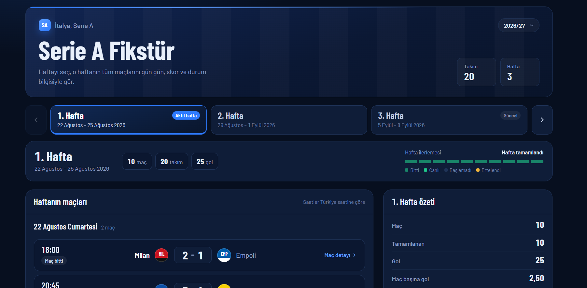
<br>

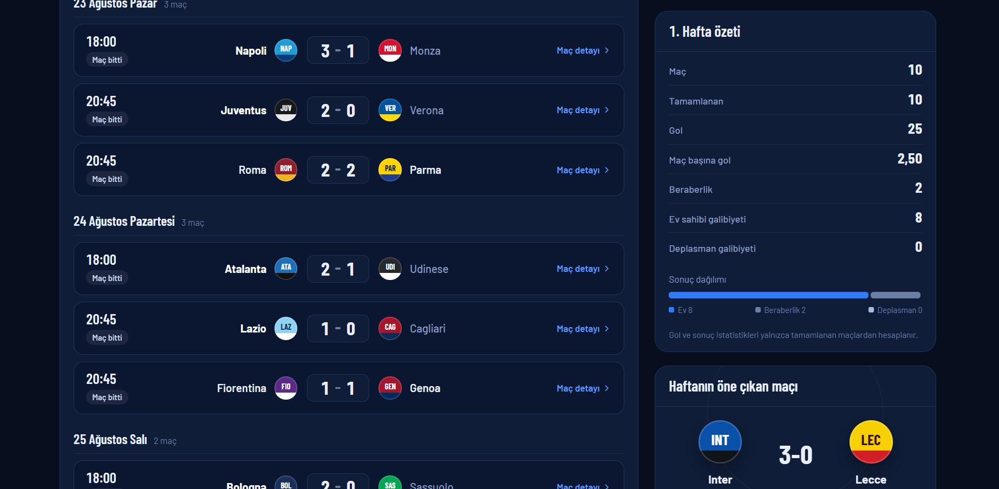
<br>

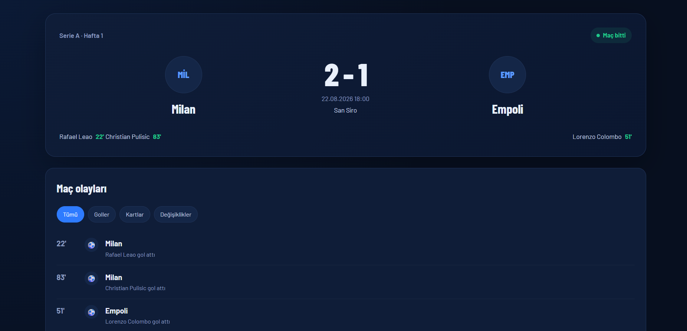
<br>

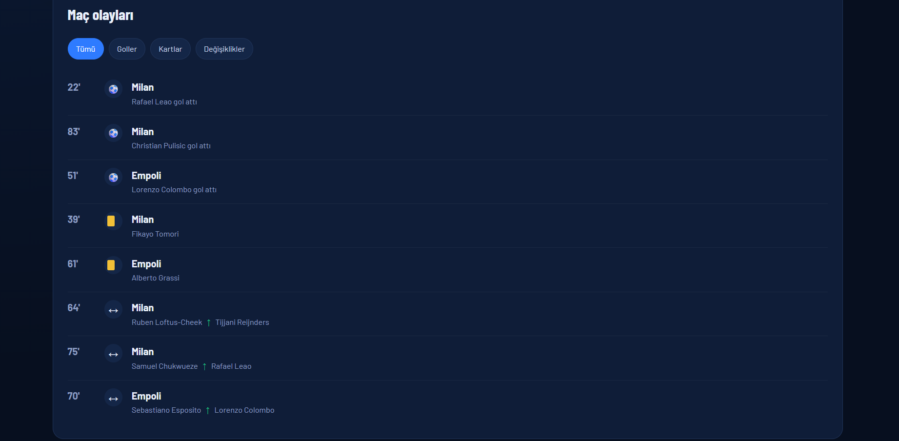
<br>

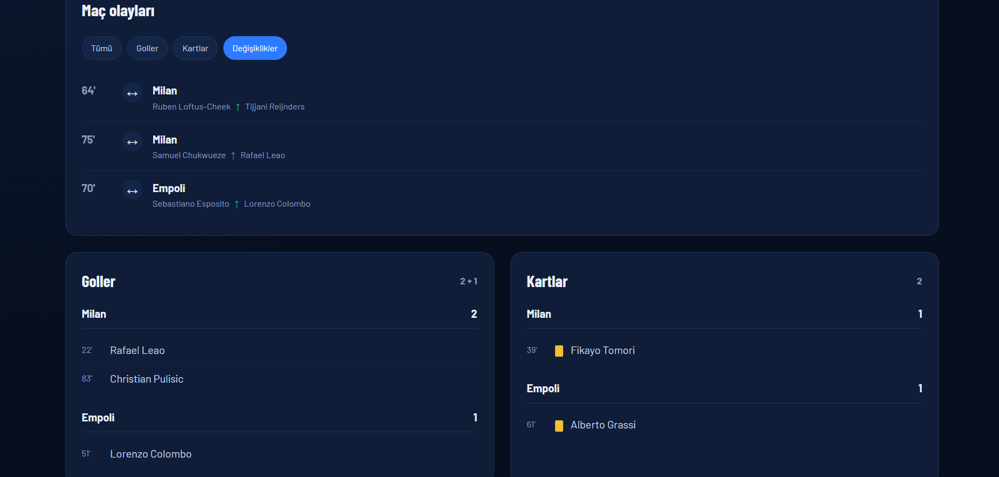
<br>

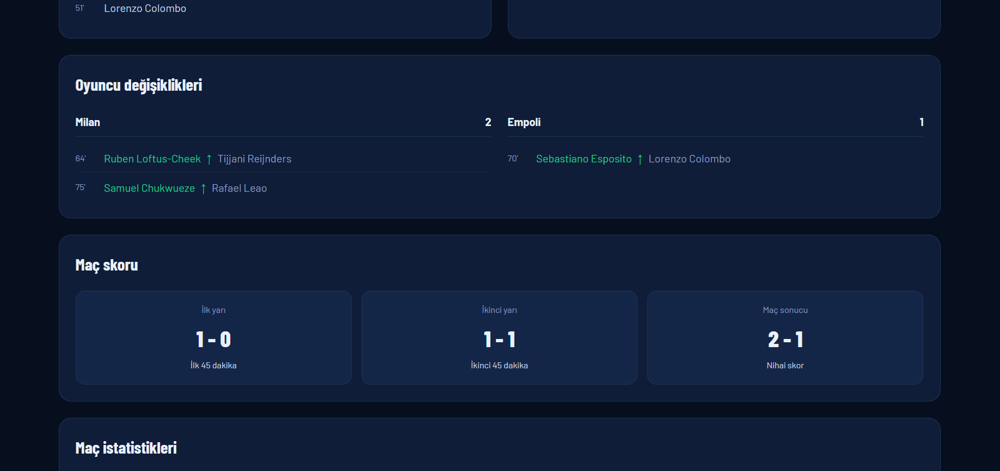

### Lig Puan Durumu
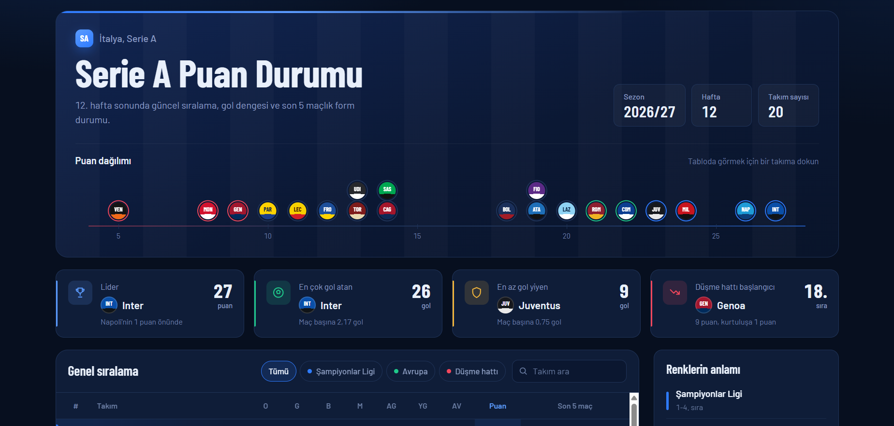
<br>

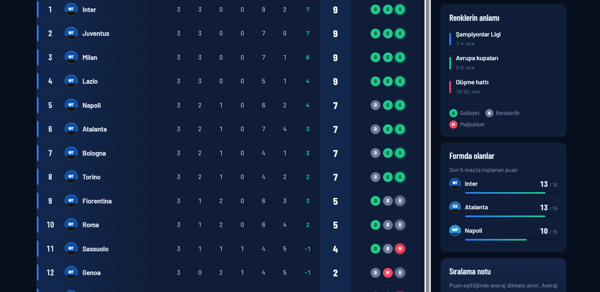

### 9. Admin Takım Yönetimi
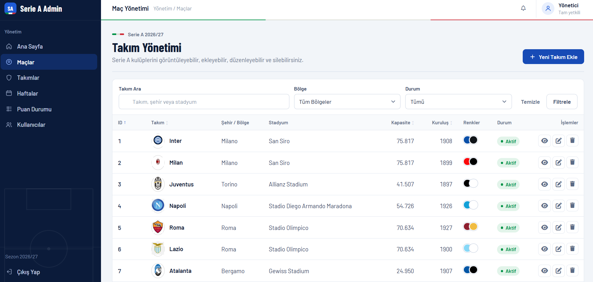
<br>

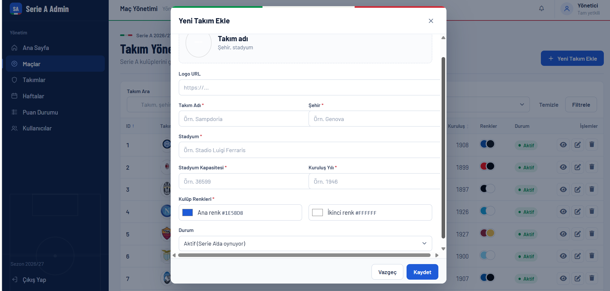
<br>
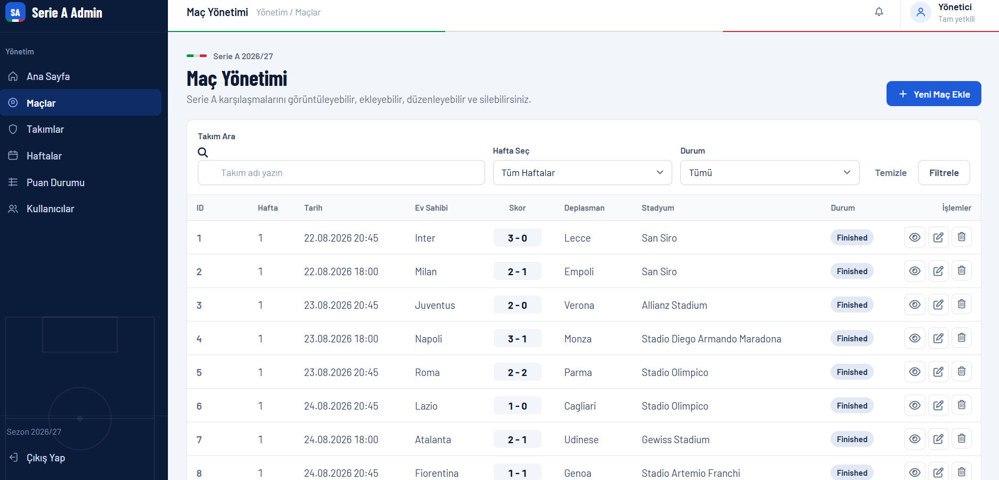
<br>
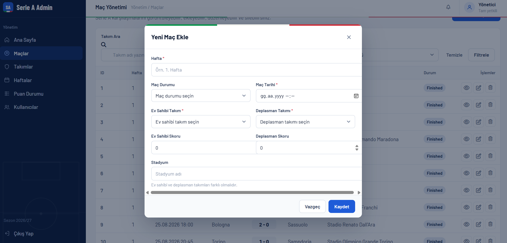
<br>

### 11. Veritabanı ve İlişkiler
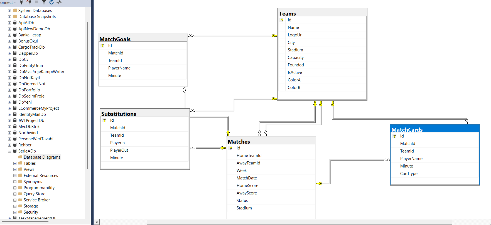

## 🔗 API Uç Noktaları

Projede kullanılan temel API uç noktaları:

## 🔗 API Endpoint'leri

### ⚽ Takım Yönetimi (Admin)

| HTTP Metodu | Endpoint | Açıklama |
|---|---|---|
| GET | `/api/admin/teams` | Tüm takımları listeler. |
| GET | `/api/admin/teams/{id}` | ID değerine göre takım detaylarını getirir. |
| POST | `/api/admin/teams` | Yeni takım oluşturur. |
| PUT | `/api/admin/teams/{id}` | Mevcut takım bilgilerini günceller. |
| DELETE | `/api/admin/teams/{id}` | Takımı siler. |

### 🏟️ Maç Yönetimi (Admin)

| HTTP Metodu | Endpoint | Açıklama |
|---|---|---|
| GET | `/api/admin/matches` | Yönetim paneli için tüm maçları listeler. |
| GET | `/api/admin/matches/{id}` | ID değerine göre maç bilgilerini getirir. |
| POST | `/api/admin/matches` | Yeni maç oluşturur. |
| PUT | `/api/admin/matches/{id}` | Mevcut maç bilgilerini günceller. |
| DELETE | `/api/admin/matches/{id}` | Maçı siler. |

### 📅 Maç İşlemleri

| HTTP Metodu | Endpoint | Açıklama |
|---|---|---|
| GET | `/api/matches` | Ev sahibi ve deplasman takımı bilgileriyle maçları listeler. |
| GET | `/api/matches/{id}` | Maç detaylarını, golleri, kartları ve oyuncu değişikliklerini getirir. |
| GET | `/api/matches/week/{week}` | Belirli haftanın maçlarını listeler. |
| GET | `/api/matches/week/{week}/summary` | Haftalık maç istatistiklerini; toplam maç, tamamlanan maç, toplam gol, ortalama gol, ev sahibi galibiyeti, deplasman galibiyeti ve beraberlik sayılarını getirir. |

### 🏆 Lig Puan Durumu

| HTTP Metodu | Endpoint | Açıklama |
|---|---|---|
| GET | `/api/standings` | Tamamlanan maçlara göre dinamik lig puan durumunu hesaplar. Takımların puan, averaj, attığı gol ve son maç sonuçlarını getirir. |

## ⚙️ Kurulum ve Çalıştırma

### Gereksinimler

- .NET 8 SDK
- SQL Server
- Visual Studio 2022 veya uyumlu bir IDE

### 1. Repoyu klonla

```bash
git clone https://github.com/Elifnaz00/MyAcademy_SerieAFootballProject.git
```

### 2. Çözümü aç

`MyAcademy_SerieA.sln` dosyasını Visual Studio ile aç.

### 3. Veritabanı bağlantısını yapılandır

`SerieA.Api` projesinin yapılandırma dosyasındaki bağlantı dizesini kendi SQL Server ortamına göre düzenle.

### 4. Migration'ları uygula

Projede mevcut migration'lar varsa Package Manager Console üzerinden `SerieA.Api` projesini başlangıç projesi olarak seçerek gerekli veritabanı güncellemelerini uygula:

```powershell
Update-Database
```

Migration'lar henüz oluşturulmadıysa önce mevcut `DbContext` üzerinden migration oluşturulmalıdır.

### 5. Projeleri çalıştır

`SerieA.Api` ve `SerieA.WebUI` projelerini birlikte çalışacak şekilde yapılandırıp başlat.

API'nin Swagger arayüzüne şu adresten erişebilirsin:

`https://localhost:7278/swagger`

> API portu, `launchSettings.json` yapılandırmasına göre değişebilir. WebUI içindeki API adresinin de kullanılan portla eşleşmesi gerekir.

## 🧠 Bu Projede Kazandığım Deneyimler

- ASP.NET Core Web API ile RESTful endpoint geliştirme
- MVC uygulamasından API tüketme
- Entity Framework Core ile ilişkisel veri modelleme
- Takım ve maçlar arasındaki ilişkileri yönetme
- LINQ ile veri sorgulama ve sıralama
- Maç sonuçlarından dinamik lig puan durumu hesaplama
- DTO ve ViewModel kullanımı
- FluentValidation ile doğrulama kuralları oluşturma
- HTTP istekleri ve hata durumlarını yönetme
- Yönetim paneli ve responsive arayüz geliştirme

## 👩‍💻 Geliştirici

**Elifnaz Demir**

Bilgisayar Mühendisliği mezunu | .NET Developer

- GitHub: [Elifnaz00](https://github.com/Elifnaz00)
- Proje: [MyAcademy_SerieAFootballProject](https://github.com/Elifnaz00/MyAcademy_SerieAFootballProject)

---

*My Yazılım Akademi kapsamında geliştirilmiştir.*
